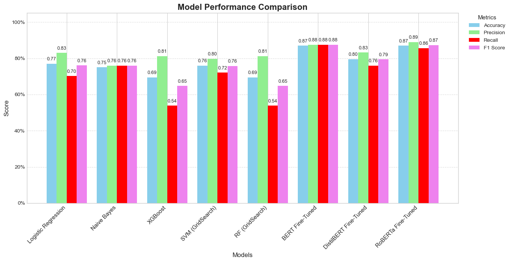
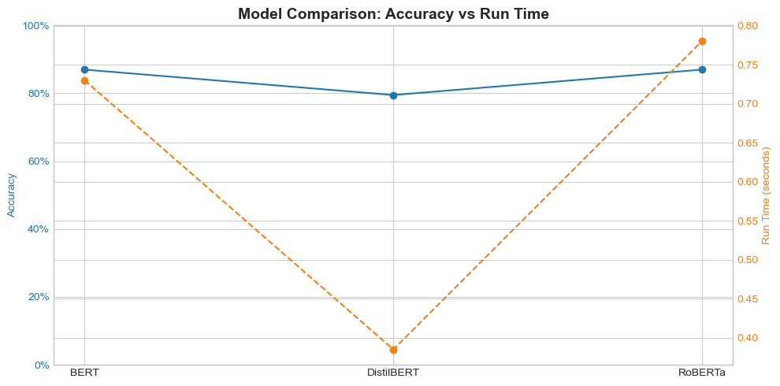
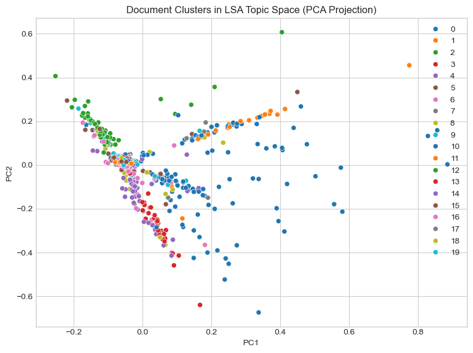

# NLP-Based Sentiment Analysis and Topic Modelling of Yelp Reviews

An end-to-end Natural Language Processing project that classifies Yelp restaurant reviews as **positive or negative** and uncovers the **main topics** customers talk about. It compares classical machine learning models with fine-tuned transformer models (BERT, DistilBERT and RoBERTa).

Completed for the *Intelligent Data and Text Analytics* module of my MSc in Data Analytics at the University of Portsmouth.



## Project goals

1. Clean and pre-process raw review text.
2. Classify sentiment using Bag-of-Words features and five classical ML models.
3. Fine-tune pre-trained transformer models and compare them with the classical approach.
4. Discover recurring themes in the reviews using topic modelling.

## Dataset

- **Source:** Yelp labelled sentences (UCI *Sentiment Labelled Sentences* dataset)
- **Size:** 1,000 reviews, perfectly balanced (500 positive, 500 negative)
- **Format:** tab-separated text: `review<TAB>label` (`1` = positive, `0` = negative)
- **Split:** 80% training / 20% test (`random_state=42`)

## Methodology

### 1. Text pre-processing (NLTK)
- Expanded contractions (e.g. *don't* → *do not*)
- Converted text to lowercase
- Removed punctuation, numbers and special characters
- Tokenised the text
- Removed stopwords
- Lemmatised words with WordNet

### 2. Classical machine learning (scikit-learn, XGBoost)
- Bag-of-Words features with `CountVectorizer`
- Models: **Logistic Regression**, **Multinomial Naive Bayes**, **XGBoost**, **Linear SVM** and **Random Forest**
- Tuned SVM and Random Forest hyperparameters with `GridSearchCV` (3-fold CV)

### 3. Transformer fine-tuning (PyTorch, Hugging Face)
- Fine-tuned `bert-base-uncased`, `distilbert-base-uncased` and `roberta-base`
- 3 epochs, batch size 16, max sequence length 128, using the Hugging Face `Trainer` API

### 4. Topic modelling
- **LDA** on count vectors; **NMF** and **LSA** on TF-IDF vectors (20 topics each)
- Visualised the top words per topic, and plotted document clusters in LSA topic space using PCA

## Results

| Model | Accuracy | Precision | Recall | F1 Score |
|---|---|---|---|---|
| Logistic Regression | 0.77 | 0.83 | 0.70 | 0.76 |
| Naive Bayes | 0.75 | 0.76 | 0.76 | 0.76 |
| XGBoost | 0.69 | 0.81 | 0.54 | 0.65 |
| SVM (GridSearch) | 0.76 | 0.80 | 0.72 | 0.76 |
| Random Forest (GridSearch) | 0.69 | 0.81 | 0.54 | 0.65 |
| **BERT (fine-tuned)** | **0.87** | 0.88 | **0.88** | **0.88** |
| DistilBERT (fine-tuned) | 0.80 | 0.83 | 0.76 | 0.79 |
| **RoBERTa (fine-tuned)** | **0.87** | **0.89** | 0.86 | 0.87 |

### Key findings
- **Transformers clearly beat classical models.** BERT and RoBERTa reached **87% accuracy**, compared with **77%** for the best classical model (Logistic Regression).
- **DistilBERT** trained in about half the time of BERT and RoBERTa, but scored lower (80%). This shows the trade-off between speed and accuracy.
- Tree-based models (XGBoost and Random Forest) had high precision but low recall on positive reviews, so they missed many positive reviews.
- Topic modelling found recurring themes such as **food quality**, **customer service** and **pricing and value**. **LDA** gave the most interpretable topics.





## Repository structure

```
NLP-Based-Sentiment-Analysis-and-Topic-Modeling-of-Yelp-Reviews/
├── data/
│   └── yelp_reviews_dataset.txt          # 1,000 labelled reviews
├── images/                               # Charts used in this README
│   ├── model_comparison.png
│   ├── transformer_accuracy_vs_runtime.png
│   └── lsa_document_clusters.png
├── notebooks/
│   └── yelp_sentiment_analysis.ipynb     # Full analysis
├── report/
│   └── yelp_sentiment_analysis_report.pdf
└── README.md
```

## How to run

```bash
git clone https://github.com/hashimpullot/NLP-Based-Sentiment-Analysis-and-Topic-Modeling-of-Yelp-Reviews.git
cd NLP-Based-Sentiment-Analysis-and-Topic-Modeling-of-Yelp-Reviews

pip install pandas numpy matplotlib seaborn scikit-learn xgboost nltk contractions torch transformers jupyter
jupyter notebook notebooks/yelp_sentiment_analysis.ipynb
```

> A GPU is recommended for the transformer fine-tuning, though it will also run on a CPU.

## Tech stack

Python · Pandas · NumPy · NLTK · scikit-learn · XGBoost · PyTorch · Hugging Face Transformers · Matplotlib · Seaborn · Jupyter Notebook

## Author

**Muhammed Hashim Pullot**, MSc Data Analytics, University of Portsmouth
[LinkedIn](https://www.linkedin.com/in/muhammed-hashim-p-666bb7221/) · [GitHub](https://github.com/hashimpullot)
